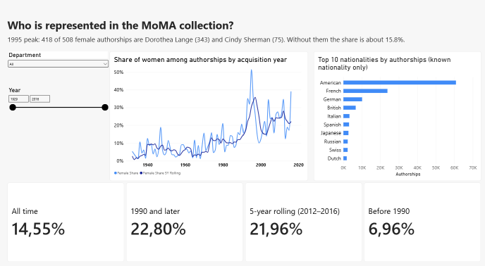
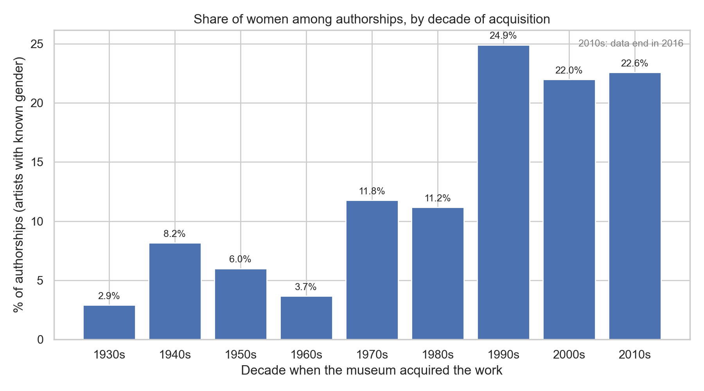
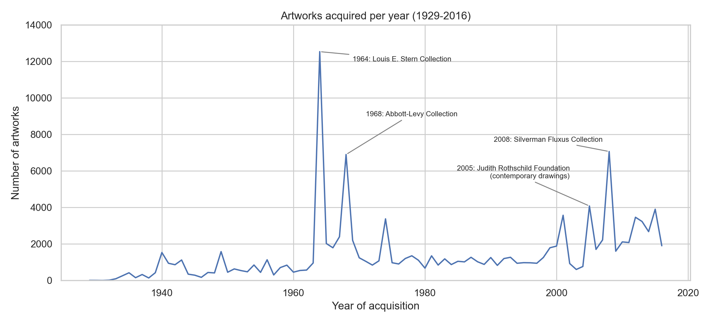
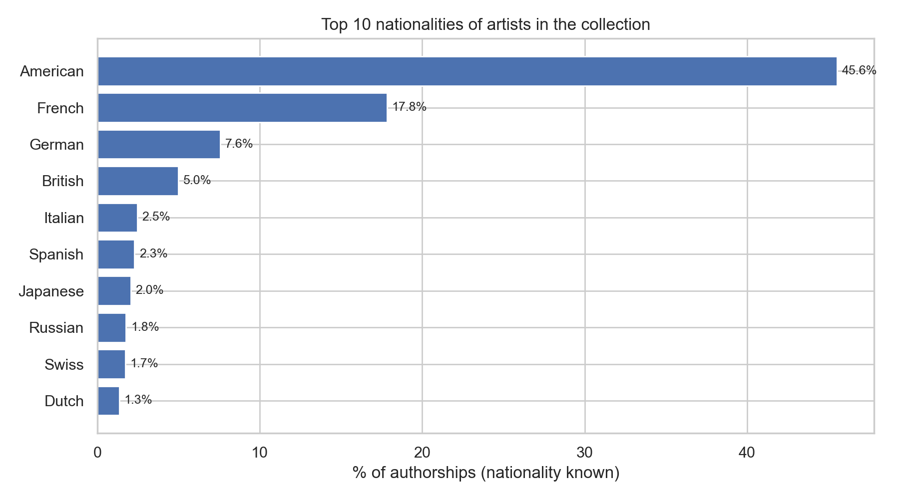
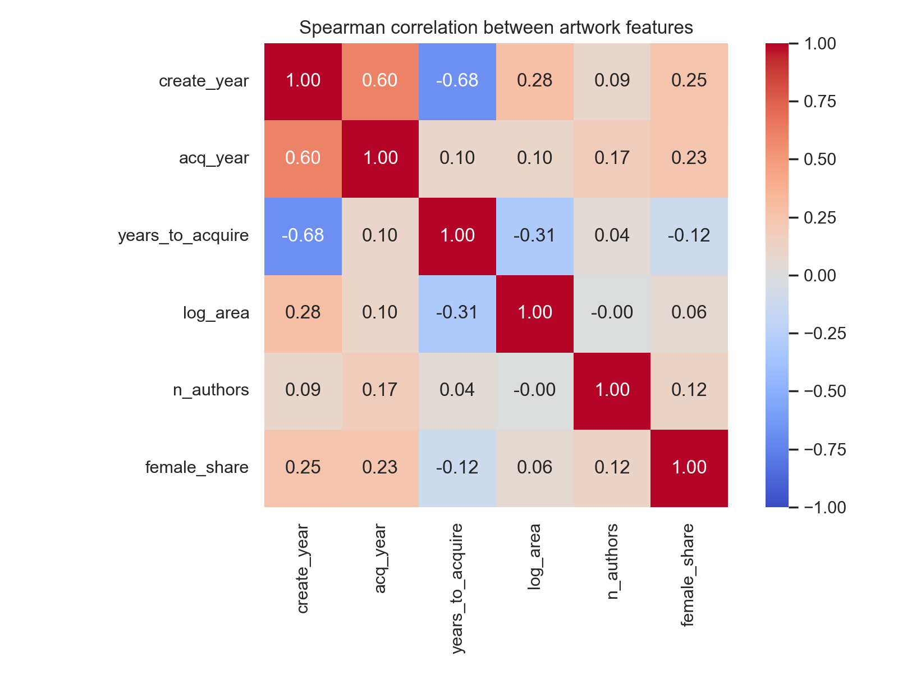
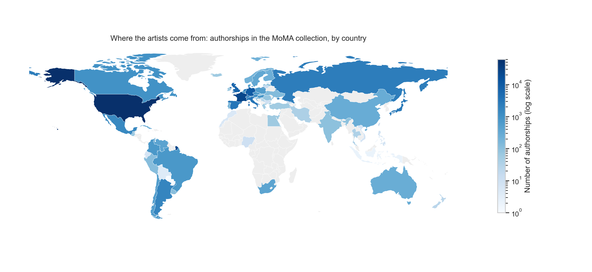

# Who is represented on the walls? Gender and geography in the MoMA collection

Data Analytics Capstone · Python · SQL (PostgreSQL) · Power BI

## Project overview

Museums decide what counts as modern art through what they acquire. This project measures who is in the Museum of Modern Art (MoMA) collection and how that changed over time:

- Is the share of women among the artists growing?
- Which nationalities dominate, and does this hold in every department?
- Do a few artists distort the picture?

## Data

- Source: Kaggle, "MoMA Museum Collection" (usability 8.24). Check the dataset page for its license before reusing the raw files.
- After cleaning: 130,262 artworks, 15,091 artists, 142,176 authorships (artwork–artist pairs).
- Unit of analysis: authorship, because one artwork can have several artists.
- This is the whole collection, not what is on display now. The data ends in 2016.

## Key findings

| Hypothesis | Result |
|---|---|
| H1: women's share is higher after 1990 | Confirmed. 7.0% before 1990, 22.8% from 1990 (chi-square, p < 0.001). A gap of 4–7 percentage points remains within the same creation decade. Overall share: 14.6% (SQL) / 14.55% (Power BI). |
| H2: American artists lead in every department | Confirmed. The USA is first in all 9 departments (39–71% of authorships with known nationality). Overall: American 45.6%, French 17.8%, German 7.6%, British 5.0%. |
| H3: artists with many works include fewer women | Weakly supported. 15.0% for artists with 21+ works vs 18.7% for artists with 1 work (p = 0.0038). The 4-group test (p = 0.0166) sits on the Bonferroni threshold (0.0167). |

Extra finding: in 1995, 418 of 508 female authorships come from two photographers (Dorothea Lange 343, Cindy Sherman 75). Without them the share is about 15.8%. One large batch can move a whole year, so the dashboard also shows a rolling 5-year share.

## Tech stack

- **Python (Jupyter)**: pandas (cleaning, one row per authorship), scipy (chi-square, Mann–Whitney, ANOVA, normality tests), seaborn/matplotlib, GeoPandas (map).
- **SQL (PostgreSQL 18)**: CTEs, JOINs, `ROW_NUMBER`, `LAG`, `NTILE`, `CASE`, `FILTER`, a calendar table.
- **Power BI**: Power Query, 4-table data model, DAX (`CALCULATE`, `DIVIDE`, `KEEPFILTERS`, `SAMEPERIODLASTYEAR`, `DATESINPERIOD`), slicers.

## Dashboard



## Charts from Python







## Repository structure

```
moma-capstone/
├── notebooks/
│   ├── 01_cleaning.ipynb      # cleaning, bridge table, new features
│   └── 02_analysis.ipynb      # EDA, hypotheses, statistical tests, charts
├── sql/
│   └── moma_queries.sql       # table setup and analytical queries
├── powerbi/
│   └── moma_dashboard.pbix    # data model, DAX measures, dashboard
├── data/
│   └── processed/             # cleaned tables used by SQL and Power BI
├── figures/                   # charts and dashboard screenshot
└── README.md
```

## How to reproduce

1. Download the raw data from Kaggle and place it in `data/raw/` (not included here).
2. Run `notebooks/01_cleaning.ipynb`. It writes the cleaned tables to `data/processed/`.
3. In PostgreSQL create a database, copy the CSV files to a folder the server can read (for example `C:/temp`), and run the blocks of `sql/moma_queries.sql` one at a time.
4. Run `notebooks/02_analysis.ipynb`.
5. Open `powerbi/moma_dashboard.pbix` and refresh the data sources if the file paths differ on your computer.

Python packages: pandas, numpy, scipy, seaborn, matplotlib, geopandas.

## Limitations

- The collection is analyzed, not the current display. Data ends in 2016.
- Gender is available only as Male or Female.
- Some dates are approximate, and placeholder values ("Unknown", "Various") were removed.
- One artist is counted many times, so observations are not fully independent.
- The recommendations in the presentation are interpretations of the results, not tested interventions.

## Author

Aisha Orynaly · SDSI master's student, University of Lapland
